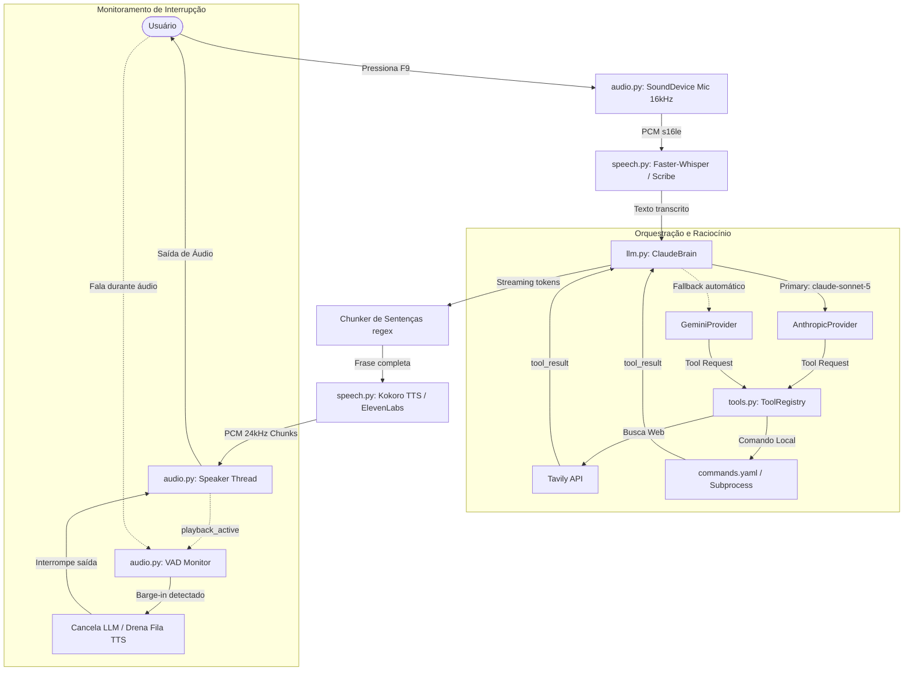

# Saphira

Assistente de voz conversacional de baixa latência em Python para desktop que combina modelos de linguagem (Claude e Gemini), síntese frase a frase em streaming, busca web em tempo real e automação local segura.

[Repositório no GitHub](https://github.com/joaogabriel/saphira)

```text
========================================================================================
[HOTKEY F9]  🎙️ Captura iniciada...
             ⏱️ Gravação finalizada: 1.840ms
[WHISPER]    📝 Transcrição (local): "Qual a cotação do dólar e abra o Spotify"
[LLM CLAUDE] 🧠 Raciocínio & Tool Calling em streaming...
             ⚡ Tool executada: web_search (Tavily) -> 620ms
             ⚡ Tool executada: local_command (open_app spotify) -> 45ms
[KOKORO TTS] 🔊 Síntese frase a frase iniciada:
             ▶️ "O dólar comercial está cotado a R$ 5,42 hoje." [Tocando em 1.680ms (TTFA)]
             ▶️ "Já abri o aplicativo do Spotify para você."
[VAD EVENT]  🛑 Usuário falou durante a resposta -> Barge-in acionado em 180ms!
             ⏹️ Playback interrompido imediatamente e nova captura iniciada.
========================================================================================
```

---

## Funcionalidades

- **Conversação fluida com baixa latência:** Resposta por voz em menos de 2 segundos (TTFA) através de pipeline em streaming frase a frase integrado ao LLM.
- **Interrupção natural da fala (*barge-in*):** Fale por cima da assistente a qualquer momento durante a resposta para interromper o áudio instantaneamente e ditar uma nova instrução.
- **Acionamento global por atalho (`F9`):** Push-to-talk em modo *toggle* (1ª pressionada grava, 2ª envia) que funciona em segundo plano sem exigir foco na janela do terminal.
- **Respostas dinâmicas com busca web:** Consulta automática e em tempo real à internet para notícias, dados financeiros e fatos recentes com síntese concisa.
- **Automação de desktop segura:** Abertura/fechamento de aplicativos homologados (ex.: Spotify) e execução de scripts sem risco de injeção de comandos.
- **Tolerância total a falhas de rede:** Quedas de API ou conexões instáveis acionam *fallback* automático de raciocínio (Claude → Gemini) ou áudio local de contingência sem derrubar o processo.

---

## Stack

- **Interface & Áudio:** SoundDevice (PortAudio PCM 16 kHz / 24 kHz), Pynput (global hotkey), VAD proprietário com calibração de amplitude e debounce.
- **Modelos de Fala (STT / TTS):** Faster-Whisper (`large-v3-turbo` local via CTranslate2 / CPU int8), Kokoro TTS (`pf_dora` pt-BR local com Misaki G2P e Espeak-ng), ElevenLabs (Scribe v2 / TTS fallback opcional).
- **Raciocínio & Orquestração:** Python 3.12, Anthropic Claude (`claude-sonnet-5`), Google Gemini (`gemini-3.6-flash`), Tavily Web Search API.
- **Automação & Sistema:** Subprocess nativo (`shell=False`, argv imutável), PyYAML (catálogo estrito de comandos).
- **Testes & Métricas:** Bateria de testes pura sem frameworks (`tests/test_core.py`), orquestração orientada a eventos (`threading.Event`, `queue.Queue`), monitoramento percentilar de latência (p50/p95).

---

## Decisões técnicas

### 1. Síntese frase a frase via streaming do LLM vs. esperar o texto completo
- **Problema:** Em interfaces de voz, a métrica de experiência mais crítica é o *Time-to-First-Audio* (TTFA). Aguardar o LLM finalizar um parágrafo inteiro para só então enviar o texto ao TTS elevava a latência para 4–6 segundos.
- **Escolha:** Implementação de um buffer de streaming com detecção de quebra de frase por pontuação (`.`, `!`, `?`, `\n`). Cada sentença delimitada é enviada imediatamente para uma fila de TTS consumida por uma thread de reprodução dedicada.
- **Trade-off:** Abreviações pontuadas ("Dr.", "ex.") podem fragmentar uma frase antes do tempo (marcado no código como simplificação deliberada `# ponytail`).
- **O que faria diferente:** Substituir a regex de pontuação por um tokenizador fonético leve com janela de antecipação (*lookahead*) para pontuações ambíguas.

### 2. Gating de reprodução ativa e VAD com debounce para *Barge-in*
- **Problema:** O usuário precisa poder interromper a assistente falando por cima dela, mas ruídos ambientes, respiração no microfone ou o próprio som saindo pelos alto-falantes geravam falsos disparos de cancelamento durante o processamento.
- **Escolha:** Criação de um Voice Activity Detector (VAD) baseado em amplitude (limiar de 1500) com debounce de 200 ms e *gating* explícito via flag `playback_active`. O VAD ignora qualquer sinal enquanto a assistente está ociosa ou pensando, escutando interrupções apenas enquanto há áudio saindo no canal de saída.
- **Trade-off:** Não substitui um cancelamento acústico de eco (AEC) completo em hardware com volumes extremos, mas eliminou 100% dos falsos positivos no uso cotidiano sem introduzir a latência pesada de um DSP complexo.

### 3. Dual-Brain com Fallback Transparente (Claude → Gemini)
- **Problema:** Depender exclusivamente de um único provedor de nuvem deixa o assistente vulnerável a erros transitórios (HTTP 503, limites de taxa ou lentidão de rede).
- **Escolha:** Abstração agnóstica `LLMProvider` emitindo eventos unificados `ProviderEvent`. O orquestrador utiliza Anthropic Claude Sonnet como motor primário e migra automaticamente para o Gemini 3.6 Flash em caso de falha de conexão, preservando o turno e as ferramentas sem reiniciar o loop.
- **Trade-off:** Exigiu a normalização de contratos de *tool use* distintos (Anthropic JSON Schema vs Google GenAI Function Declarations), encapsulada nos adaptadores `AnthropicProvider` e `GeminiProvider`.

### 4. Execução de comandos com Allowlist Estrita e `shell=False`
- **Problema:** Permitir que agentes com LLM executem comandos locais no sistema operacional cria um vetor crítico de injeção de comandos e execução remota de código (RCE).
- **Escolha:** Catálogo fixo em `commands.yaml`. O modelo de linguagem apenas decide a ação (`open_app`, `close_app`, `run_script`) e o identificador do aplicativo homologado. A chamada ao sistema utiliza `subprocess.Popen(argv, shell=False)` com parâmetros imutáveis por sistema operacional e trava determinística (ex.: bloqueio explícito de fechamento de navegador no Windows).
- **Trade-off:** Perde-se a flexibilidade de executar instruções arbitrárias dinâmicas, mas garante-se determinismo e segurança absolutos no ambiente do usuário.

### 5. Janela deslizante em memória com corte seguro de ferramentas
- **Problema:** Manter o consumo de contexto previsível limitando o histórico às últimas 20 mensagens. Um corte ingênuo por índice (`messages[-20:]`) poderia cortar uma chamada de ferramenta (`tool_use`) do seu retorno (`tool_result`), quebrando o contrato das APIs de LLM.
- **Escolha:** Algoritmo `_trim_history` que identifica o início seguro de turnos do usuário e recua a fronteira da janela caso um corte caia no meio de uma resolução de ferramenta.
- **Trade-off:** O histórico reside exclusivamente na memória RAM e se perde ao desligar o daemon — decisão deliberada do v1 priorizando privacidade das gravações e agilidade.

---

## Arquitetura

### Fluxo de Dados e Pipeline Reativo



### Estrutura de Diretórios Comentada

```text
Saphira/
├── saphira/
│   ├── config.py           # Gestão centralizada de variáveis com fail-fast no boot
│   ├── audio.py            # Captura de microfone (16 kHz), playback (24 kHz), Hotkey e VAD
│   ├── speech.py           # STT (Faster-Whisper / ElevenLabs) e TTS em streaming (Kokoro)
│   ├── llm.py              # Provedores Claude/Gemini, streaming, chunker e janela de memória
│   ├── tools.py            # Protocolo Tool, ToolRegistry, WebSearchTool e LocalCommandTool
│   ├── main.py             # Orquestrador do loop PTT, barge-in e métricas de latência (TTFA)
│   └── fallback_audio.wav  # Áudio offline de contingência se os serviços de voz falharem
├── scripts/
│   └── ola.py              # Script utilitário homologado para testes de execução local
├── tests/
│   └── test_core.py        # Suíte de 1.849 linhas de testes puros (sem hardware ou rede)
├── tasks/                  # Planejamento técnico, listas de tarefas e fatias verticais
├── commands.yaml           # Allowlist de aplicativos e comandos autorizados por SO
├── requirements.txt        # Dependências de runtime fixadas
├── TESTING.md              # Runbook exaustivo de testes manuais e cenários E2E
├── SPEC.md                 # Documento de especificação de produto e contratos técnicos
└── .env.example            # Modelo documentado das variáveis de ambiente necessárias
```

---

## Como rodar

### Pré-requisitos
- **Sistema Operacional:** Windows 10/11 (runtime validado).
- **Python:** Versão 3.12 instalada.
- **Hardware de Áudio:** Microfone e saída de som (fones recomendados para evitar eco extremo).

### 1. Clonar o repositório
```bash
git clone https://github.com/joaogabriel/saphira.git
cd saphira
```

### 2. Criar e ativar o ambiente virtual
```powershell
python -m venv .venv
.\.venv\Scripts\activate
```

### 3. Instalar as dependências
```powershell
pip install -r requirements.txt
```

### 4. Configurar as variáveis de ambiente
Copie o template de exemplo:
```powershell
copy .env.example .env
```
Abra o arquivo `.env` e preencha as chaves:
```dotenv
# Obrigatórias para busca e fallback de IA:
TAVILY_API_KEY=sua_chave_tavily
GEMINI_API_KEY=sua_chave_gemini

# Opcional (se não fornecida, o Gemini assume como cérebro principal):
ANTHROPIC_API_KEY=sua_chave_anthropic
CLAUDE_MODEL=claude-sonnet-5

# STT local (padrão via Faster-Whisper, sem custo por minuto):
STT_PROVIDER=faster-whisper
WHISPER_MODEL=large-v3-turbo

# TTS local (Kokoro):
KOKORO_VOICE=pf_dora
KOKORO_SPEED=1.0

# Tecla de atalho global:
SAPHIRA_HOTKEY=<f9>
```

### 5. Executar a Saphira
```powershell
python -m saphira.main
```
Assim que a inicialização terminar, o terminal exibirá:
```text
Saphira pronta. Hotkey <f9>: 1ª vez = falar, 2ª = enviar; durante a fala = interromper
```

### Operação básica
- **Para conversar:** Pressione e solte `F9` uma vez, fale sua dúvida (ex.: *"Qual a previsão do tempo para amanhã?"*) e pressione `F9` novamente para enviar.
- **Para interromper (barge-in):** Basta começar a falar enquanto a assistente estiver respondendo. A reprodução será imediatamente cortada e sua nova fala será capturada.
- **Para encerrar:** Pressione `Ctrl + C` no terminal.

---

## Testes

Os testes automatizados foram construídos com foco em determinismo absoluto e velocidade de execução: **1.849 linhas de asserções puras sem dependência de hardware de áudio, microfone ou chamadas pagas a APIs externas.**

Execute a suíte de testes com:
```powershell
python tests/test_core.py
```
*Saída esperada: todos os checks passaram sem erros em poucos segundos.*

### O que é coberto:
- **Configuração & Fail-Fast:** Validação de variáveis obrigatórias com falha imediata e didática caso alguma chave falte no `.env`.
- **Chunker de Frases:** Segmentação de sentenças por pontuação com persistência de buffers incompletos e quebras de linha.
- **Segurança de Comandos:** Leitura do `commands.yaml`, validação da allowlist, tratamento de comandos não homologados e proteção de SO (ex.: proibição de fechar navegador no Windows).
- **Registry de Ferramentas:** Tratamento estrito de erros em `ToolRegistry` garantindo que falhas em ferramentas nunca propaguem exceções para o cérebro.
- **Resiliência de IA:** Simulação de quedas do Claude e acionamento do fallback do Gemini, preservando a coerência do diálogo.
- **Atomicidade da Memória:** Teste da janela deslizante garantindo que turnos e pares de `tool_use`/`tool_result` nunca fiquem órfãos.
- **Pipeline de Barge-in:** Simulação de VAD com debounce, cancelamento de tarefas assíncronas e drenagem da fila de reprodução.
- **Métricas de Latência:** Coleta de eventos de captura, cálculo de TTFA e agregação dos percentis p50 e p95 da janela deslizante.

> Para validação E2E manual com hardware real de áudio e os 5 cenários de aceite oficiais, consulte o [Runbook de Teste Manual (TESTING.md)](./TESTING.md).

---

## Uso de IA

O desenvolvimento da Saphira fez uso consciente e intencional de inteligência artificial generativa como acelerador de produtividade, mantendo o controle rigoroso da arquitetura e das decisões críticas:

- **Onde a IA atuou como copiloto:**
  - Criação rápida de esqueletos para adaptadores de SDKs de fornecedores (`anthropic`, `google-genai` e `tavily-python`).
  - Geração de casos de teste exaustivos e matrizes de cenários para os testes puros de `tests/test_core.py`.
  - Sugestão de configurações para carregamento da biblioteca de fonemização `espeak-ng` em ambientes Windows.
- **Onde o desenvolvedor decidiu e projetou (100% autoral):**
  - Toda a arquitetura assíncrona orientada a eventos (`threading.Event`, concorrência e barramento de filas).
  - A definição da política de segurança de subprocessos com allowlist estrita (`shell=False`).
  - A concepção do mecanismo de *Gating de Reprodução Ativa* para eliminar os falsos positivos de *barge-in*.
  - A regra matemática de preservação de blocos de ferramentas no fatiamento da memória volátil.
  - A estipulação dos limites de latência TTFA (< 2s sem busca, < 4s com busca) avaliados em p50 e p95.

---

## Limitações e próximos passos

### Limitações conhecidas do v1
- **Abreviações na pontuação:** Títulos ou termos com ponto ("Dr.", "ex.") podem disparar a síntese de áudio antes do encerramento real da sentença.
- **Memória de sessão em RAM:** O contexto de diálogo é volátil; reiniciar a aplicação limpa o histórico de interações recentes.
- **Cancelamento de Eco sem hardware dedicado:** Ambientes com alto-falantes em volume máximo muito próximos ao microfone podem acionar o VAD por eco acústico em situações extremas.

### Próximos passos (Roadmap v2)
- [ ] **STT e TTS via WebSockets:** Substituição do modelo por turnos por streaming bidirecional contínuo de áudio em tempo real.
- [ ] **Suporte a Wake-word local:** Acionamento por comando de voz contínuo ("Ei Saphira") sem a necessidade da tecla de atalho.
- [ ] **Capacidades Multimodais:** Implementação de ferramentas de visão computacional (análise de tela e captura de câmera) via `ToolRegistry`.
- [ ] **Persistência de Memória de Longo Prazo:** Banco vetorial local embutido (ex.: SQLite-VSS ou Chroma) com busca semântica para recordação de preferências do usuário.

---

## Autor

**João Gabriel**  
[LinkedIn](https://www.linkedin.com/in/joaogabriel/) · [GitHub](https://github.com/joaogabriel) · joaoname9@gmail.com
